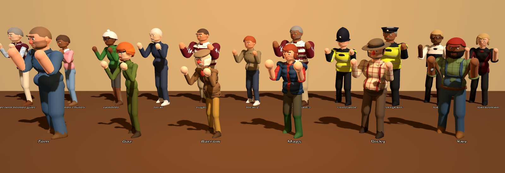
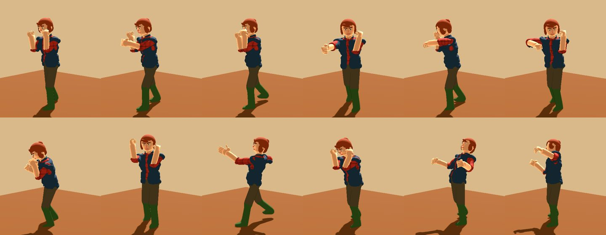
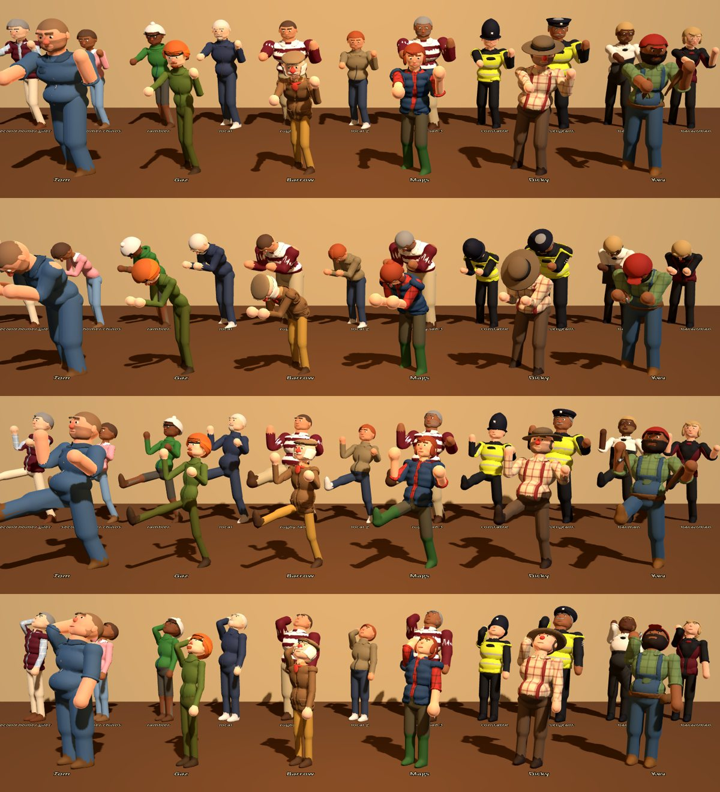
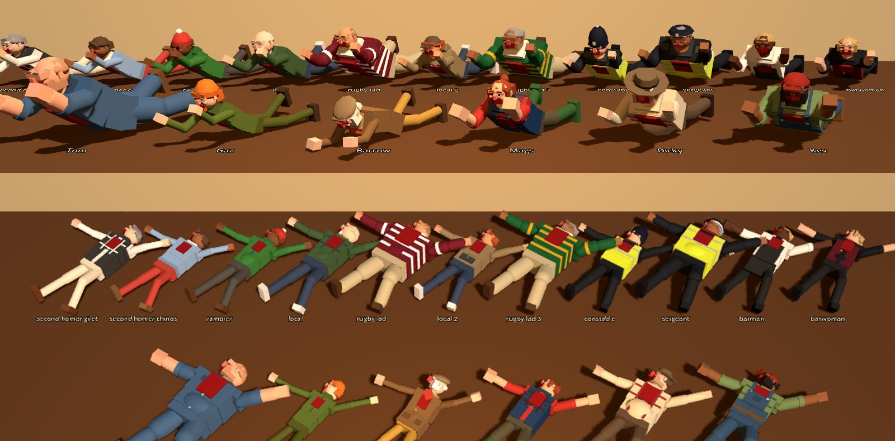

# Characters and animation

Workstream 8. Every person in the game (six farmers, the punters, the police and the bar
staff) is a **rigged, skinned model** built in Blender on **one shared armature**, driven by
`CharacterRig` and dressed from a **look** (`CharacterLook`, data in `CharacterLooks`).
The rig retargets the full animation set onto each model's skeleton, and knockouts hand
over to a **physics ragdoll**.



Open `scenes/actors/character_lineup.tscn` and press F6 to see everyone. Left/Right cycles the
animation, B toggles blood, C switches to the in-game camera angle, K knocks everyone out
into ragdolls.

## How the models are made

`tools/blender/build_characters.py` builds every model from the look data. No hand-made art
files are needed, and changing a look and rebuilding takes about a minute for all 15.

- **Bodies** are a quick procedural sculpt: ellipsoids and capsules for the torso, belly
  and limbs are voxel-remeshed into one watertight surface, smoothed so the joins
  fillet, and decimated. Each body part is remeshed separately so an arm never welds to
  the torso, and the part is remembered per vertex so skin weights never bleed across.
- **Anatomy:** pecs, trapezius, shoulder blades and backside on the torso, deltoids,
  biceps, triceps and forearms on the arms, quads, hamstrings, kneecaps and calves on the
  legs, so the body reads as a person under the clothes.
- **Footwear** has a sole, a heel block and a welt under every boot and shoe.
- **Hands** are their own finer sculpt: a palm, four fingers and a thumb, so fists clench,
  hands open to grab and fingers wrap a pint.
- **Heads** are sculpted the same way (cranium, jaw, brow ridge, cheeks, chin) with a
  separate nose on its own bone, ears, lips, eyebrows and eyes.
- **Clothes, hair and beards** are shells grown off the body or head surface (gilets,
  waistcoats, bibs, braces, hi-vis, collars, cuffs, pockets, hair caps, beards and stubble),
  with hems relaxed so cut edges read as seams. Hats are small modelled pieces.
- **Colours** come from named materials (`skin`, `top`, `trousers`, `over`, `hat`...).
  Godot recolours them from the look, so one model serves a whole crowd type. Shirts get a
  check pattern mapped triplanar, so the models need no UVs.
- **Variants**: optional pieces are separate meshes called `Hair_<STYLE>`, `Beard_<STYLE>`,
  `Hat_<STYLE>` and `Top_<TYPE>`. Each crowd model carries every piece its type can roll,
  and Godot shows the ones that match. `Blood_*` meshes appear as a fighter gets hurt.
- **Armature** (all models share these names, L and R where paired):
  - spine and head: `Hips`, `Spine`, `Spine2`, `Chest`, `Neck`, `Head`
  - face: `Nose`, `Jaw` (opens the mouth, carries the chin and beard), `BrowL`/`BrowR`
    (pivot at the outer end, so a twist frowns or winces)
  - arms: `Clavicle`, `Shoulder`, `Elbow`, `Hand`
  - fingers: `Thumb1/2`, `Index1/2`, `Fingers1/2` (middle, ring and little finger together)
  - legs: `Hip`, `Knee`, `Foot`

Rebuild after changing `CharacterLooks`:

```
godot --headless --path . --script res://tools/export_looks.gd      # looks -> looks.json
blender -b -P tools/blender/build_characters.py                      # all models (Blender 4.5)
blender -b -P tools/blender/build_characters.py -- --blend tom gaz   # some, plus .blend files
godot --headless --path . --import                                   # reimport the .glb files
```

`--blend` also saves `tools/blender/out/<id>.blend` (not committed) so you can open a model,
tweak it or hand-sculpt over it. A hand-made model works as long as it keeps the bone names,
the material names and the piece names above. `tools/blender/preview.py` renders .blend files
with Cycles for a quick look without Godot.

## The six farmers

Ids match `GameData.FARMERS`. Each silhouette is meant to read from the high camera: you can
tell them apart by height, width, posture and hat.

| Id | Farmer | Look | How the trait shows |
| --- | --- | --- | --- |
| `tom` | Tom "Muckspreader" Pryce | The giant. Shaved head, stubble, rolled-sleeve boiler suit, rigger boots | Huge head and heavy brow ridge (iron forehead) |
| `gaz` | Gaz Whitlock | The whippet. Thin, long arms, ginger mop and goatee, orange beanie, ripped fleece | Long limbs for quick flurries |
| `barrow` | Old Man Barrow | Bent old boy. Tweed flat cap, white mutton chops, wax jacket, waistcoat, mustard cords, neckerchief | Stoop, and a big plum-red drinker's nose |
| `mags` | Margaret "Mags" Fenwick | Sturdy dairy farmer. Auburn bun, red check shirt, navy quilted gilet, green wellies | The biggest hands for her size (vice grip) |
| `dicky` | Dicky Thresher | The drunk. Battered trilby, comb-over, cream shirt, braces over a full ale belly | Sways on his feet all the time (drunken master) |
| `kev` | Kev Haybale | The handyman. Full black beard, red cap, bib-and-brace overalls, tool belt with a hammer | Tool belt (handyman) |

## Punters, police and staff

Looks only. How tough each type is belongs to the AI workstream.

| Id | Who |
| --- | --- |
| `second_homer_gilet` | Navy gilet, pale shirt, stone chinos, loafers |
| `second_homer_chinos` | Red trousers, jumper over a collar, floppy hair |
| `rambler` | Cagoule, bobble hat, walking shorts, glasses |
| `local` | Hoodie, jumper or fleece, jeans, trainers. The most varied type |
| `rugby_lad` | Big shoulders, hooped rugby shirt, thick neck |
| `constable` | Custodian helmet, black jacket, hi-vis vest |
| `sergeant` | Peaked cap, sleeve stripes, moustache, bigger build |
| `barman`, `barwoman` | White or black shirt with apron or waistcoat |

Crowds should never be clones, so `CharacterLooks.punter(type, seed)`, `police(type, seed)`
and `staff(type, seed)` vary skin tone, hair, build and clothing colours. **The same type and
seed always give the same person**, so use a seed every peer agrees on, such as the number in
the NPC's node name (`N12` → 12). That keeps a punter looking the same on every machine
without syncing their look.

## Using the rig

```gdscript
var rig := CharacterRig.new()
rig.look = CharacterLooks.farmer("mags")       # or rig.look_id = "rugby_lad"; rig.look_seed = 12
add_child(rig)

rig.set_move_speed(velocity.length())          # every frame: switches idle and walk
rig.set_guard(in_stance or mood != Npc.Mood.CALM)  # fists up only when there's trouble
rig.set_talking(chatting_with != null)         # calm chatters gesture
rig.staff = true                               # before add_child: bar staff polish glasses
rig.play_move("punch")                         # alternates left and right
rig.play_state(Fighter.State.keys()[state])    # "STAGGER", "KO", "HELD"...
rig.play_hit(from_front, heavy)
rig.get_socket(&"hand_r").add_child(bottle)    # weapons, pints
rig.play_hit(true, false, hit_direction)       # remembers the direction for a ragdoll
rig.play_state("KO")                           # goes ragdoll, thrown along hit_direction
rig.start_ragdoll(impulse)                     # or do it yourself, any time
rig.ragdoll_hips_position()                    # where the body landed (for get-up / revive)
rig.set_blood(0.7)                             # cosmetic, 0 to 1
rig.break_nose()                               # hook to Events.nose_broken
rig.animation_finished.connect(...)            # e.g. to time the hit frame
```

### Calm and guarded

People start relaxed. Standing still, a calm character plays one of the calm idles
(`idle_relaxed` with weight shifts, or `idle_pint` with a sip now and then, picked from
`look_seed`), `idle_chat` while talking, or `idle_polish` for staff. Walking calm is
`walk_relaxed`. Only with the guard up do they play the fists-up `idle` and `walk`.
Any move or hit raises the guard on its own; `set_guard(false)` drops it again.

`FighterVisual` drives this for you: the guard is up while the fighter is in a fighting
stance (`Fighter.in_stance`) or, for NPCs, while their AI mood is ALERT or ENGAGED (mood is
synced so clients match). Staff never square up.
Every standing loop starts at a random point so a room doesn't move in step.

The rig is a `@tool` script, so you can drop a `CharacterRig` node into any scene, set
`look_id`, and see the character in the editor.

### Ragdoll

Each rig builds a `PhysicalBoneSimulator3D` with capsule bodies and cone joints for the hips,
spine, chest, head, arms and legs. `play_state("KO")` switches to it (turn off with
`ragdoll_on_ko`), and any later `play()` or `play_state()` switches back to animation.

- Ragdolls are **cosmetic**: every peer runs its own, so they never decide gameplay. The
  fighter's own body and KO state stay host-authoritative as usual.
- They sit on physics layer 7 (`ragdoll`) and only collide with the world (layer 1), so
  bodies don't trip the living or pile up on each other.
- When a downed fighter gets up or is revived, move the fighter to `ragdoll_hips_position()`
  first, then play `get_up`.

### Contract

These names are the contract with gameplay. Real art must keep them.

- **Facing** is -Z. The origin is on the floor between the feet. 1.0 scale is about 1.78 m.
- **Animations** (`CharacterRig.ANIMATIONS`): `idle`, `walk`, `idle_relaxed`, `idle_pint`,
  `idle_chat`, `idle_polish`, `walk_relaxed`, `punch_l`, `punch_r`, `kick`,
  `headbutt`, `windup`, `swing`, `throw`, `grab`, `hold`, `held_struggle`, `hit_front`,
  `hit_back`, `stagger`, `knockdown`, `down`, `get_up`, `crawl`, `ko`, `drink`, `eat`,
  `dodge`, `cheer`, `taunt`, `block`, `hook_l`, `hook_r`, `uppercut_r`, `hit_left`,
  `hit_right`.
- **Fighter states** map one to one (`CharacterRig.STATE_ANIMS`):

  | State | Animation | Notes |
  | --- | --- | --- |
  | IDLE | a calm idle, `idle` or a walk | Picked from `set_move_speed`, guard, talking and staff |
  | ATTACK | `punch_r` | Use `play_move()` for the actual move |
  | WINDUP | `windup` | The big telegraphed haymaker. Holds on the last frame. Counter window |
  | STAGGER | `stagger` | |
  | DOWN | `knockdown` then `down` | Lying on the back, groggy |
  | CRAWL | `crawl` | Face down, dragging along. Pair with moaning |
  | KO | `ko` | Falls and lies still |
  | HELD | `held_struggle` | Arms pinned, kicking |
  | GRABBING | `grab` then `hold` | |
  | DODGE | `dodge` | Duck and weave |

- **Moves** (`CharacterRig.MOVE_ANIMS`): every move id in `scripts/combat/moves.gd` maps to
  an animation. The boxing set is distinct: jab `punch_l`, cross `punch_r`, hook `hook_r`
  (`hook_l` for the lead hand) and uppercut `uppercut_r`. A few others still share the
  nearest one (haymaker, counter and shove use the punches; knee and stomp use the kick).
- **Hit reactions**: `play_hit(from_front, heavy, direction)` picks `stagger` for heavy blows,
  `hit_back` from behind, `hit_left`/`hit_right` when the blow comes across (a hook whips the
  head round) and `hit_front` for a straight shot.
- **Chains**: `knockdown` → `down`, `grab` → `hold`. Attacks, hit reacts, `get_up`,
  `drink`, `eat`, `cheer` and `taunt` return to idle (turn off with `auto_return_to_idle`).
- **Sockets** (`get_socket`): `hand_r`, `hand_l`, `head`, `chest`, `hold_point` (where a
  held enemy goes, in front of the chest).

### Timings

Every strike has a **load** (the end of its wind-up: weight back, the punching side coiled)
and a **contact** (the blow lands). `rig.load_time(anim)` and `rig.contact_time(anim)` return
them, so combat can stretch the wind-up to fill a move's telegraph and release on time.

| Animation | Length | Load | Contact |
| --- | --- | --- | --- |
| `punch_l` (jab) | 0.38 s | 0.06 s | 0.10 s |
| `punch_r` (cross) | 0.46 s | 0.08 s | 0.13 s |
| `hook_l` / `hook_r` | 0.52 s | 0.10 s | 0.16 s |
| `uppercut_r` | 0.6 s | 0.13 s | 0.19 s |
| `kick` | 0.62 s | 0.14 s | 0.22 s |
| `headbutt` | 0.56 s | 0.16 s | 0.24 s |
| `swing` | 0.72 s | 0.22 s | 0.32 s |
| `throw` | 0.6 s | 0.18 s | release at 0.3 s |
| `windup` | 0.55 s | 0.55 s (holds) | |
| `drink` / `eat` | 1.6 s | | heal at about 1.1 s |

To retime a strike, move its keys in `CharacterRig._anim_defs()` along with its `load` and
`contact`, and update this table.

## How the animations work

The animations are pose data in `CharacterRig._anim_defs()`: joint rotations in the
character's own axes, keyed in time. At load time they are retargeted onto each model's
skeleton (a bone's pose rotation is `rest_local * (M⁻¹ q M)`, where M is the bone's rest
orientation), so one set of data drives every model whatever its proportions. A
hand-keyed Blender action could later replace any of them by name.

What makes them move like a person rather than a puppet:

- **Splines and eases.** Poses are baked at 30 fps. Between keys the motion follows a spline
  through the neighbouring keys, so it never stops dead at a key. A key can ask for an ease
  on the way in: `"io"` settles into it (loads, holds), `"snap"` accelerates into it (the
  impact), `"out"` decelerates (recoveries), `"lin"` is even.
- **Follow-through.** Joints further from the hips trail a little (`OVERLAP`): the hips
  lead, then the chest, the head, the jaw and the fingers. A punch starts in the legs and a
  blow rolls up into the head.
- **Filled-in joints.** `_expand()` shares a spine bend over `Spine` and `Spine2` and a head
  turn with the neck, moves the collarbones with the arms (a punch reaches with the
  shoulder), plants the feet flat, and drives the hands and face from a few scalars:
  `_fistL`/`_fistR` (0 open, 1 clenched), `_jaw` (0 shut, 1 wide), `_brow` (+1 scowl, -1
  wince) and `_heelL`/`_heelR` (lift the heel, the pivot on a cross).
- **Weight.** Every punch loads first (weight back, the punching side coiled), drives from
  the hips with a pivot on the foot, holds a beat at full extension and settles back into
  a bladed boxing guard. Hits snap the head away, then a stagger step catches the weight.



Baking is the slow part (about 0.1 s per model), so characters built from the same model
share one animation library.

### The fight set

`RigFightAnims` (scripts/actors/rig_fight_anims.gd) adds the extended set on top, from the
same guard:

- **Stances and footwork:** each fighter squares up their own way, picked by seed
  (`FIGHT_IDLES`: boxer, pub brawler, wary). With the guard up, `set_move_vector()` picks
  walking in, backpedalling (`walk_back`) or side-stepping (`strafe_l`/`strafe_r`).
- **Variants:** `VARIANTS` lists several takes of each strike (a slipping jab, a double jab,
  an overhand right, wide looping hooks, a lead uppercut, a chopping uppercut, a teep, a
  low kick, a lapel-grab headbutt). `play_move()` picks one at random; every take keeps the
  load/contact timing of the move it varies.
- **Body shots:** `play_move(move, &"body")` throws `jab_body`, `cross_body`,
  `hook_l_body`/`hook_r_body` (shovel hooks) or `uppercut_body`.
- **New moves:** `clinch_knee` (both hands behind his head, drag down, knee up),
  `shoulder_charge`, `groin_kick`, and the punter's `body_swing`.
- **Defence:** `set_guard_zone(&"head")` (LB, gloves to the temples) or `&"body"` (RB,
  elbows on the ribs), `play_block_hit()`, `play_parry()` (`parry_l`, `parry_r`),
  `play_dodge(world_dir)` (`dodge_l`/`_r`/`_back`/`_fwd`), `slip_l`/`slip_r`.
- **Reactions:** `play_hit(from_front, heavy, dir, zone, move)`. Head shots snap back or to
  the side, an uppercut lifts the chin (`hit_uppercut`), body shots fold (`hit_body`,
  `hit_body_l`/`_r`), and `zone = &"groin"` plays `groin_down`, which chains into the
  `groin_hold` loop on all fours. `play_clinched()` is the knee's victim.

### The procedural layer

`RigReactor` is a `SkeletonModifier3D` under the skeleton that runs after the animation each
frame, so hits don't look canned:

- **Head snap and body flinch:** every hit kicks a damped spring that whips the head away
  from the blow (back, round to the side for a hook, up for an uppercut) or folds the
  torso, then wobbles it back, whatever animation is playing underneath.
- **Head movement:** `set_head_bob(Vector2)` (right stick; x slips, +y ducks, -y leans
  back) bends the spine and the legs together so the feet stay put.
- **Breathing:** the chest rises and falls, harder as they get hurt.

It is switched off while ragdolling. Note that `get_bone_global_pose()` shows the animated
pose; sockets (BoneAttachment3D) follow the modified one.

### Materials

The models have no UVs or tangents, so `_material()` adds surface detail as a tiling noise
mapped triplanar into the colour and roughness (`SURFACES`): a weave mottle on cloth,
blotches on skin (plus subsurface scattering), grain on leather and boots (with a light
clearcoat), strands in hair (anisotropic), glossy eyes.

## Performance

Models are 25k to 48k triangles with every variant included (only the shown pieces draw),
and Godot generates LODs on import, so a crowd in the high camera draws far fewer. The 15
`.glb` files are about 23 MB in the repo.

## Tests and tools

- `godot --headless --path . --script res://tests/character_test.gd` (after `--import`) builds
  every look, plays every animation, and checks sockets, state mapping, crowd variation,
  that the floor animations really are on the floor, and that a KO ragdoll falls the way it
  was hit and hands back to animation. The headless dummy renderer prints a few harmless
  `Parameter "material" is null` lines.
- `xvfb-run godot --path . --rendering-driver opengl3 --script res://tools/capture_characters.gd -- <dir>`
  renders the line-up to PNGs, which is how the images in this file were made.
- `xvfb-run godot --path . --rendering-driver opengl3 --script res://tools/capture_moves.gd -- <out.png> tom side punch_r@0,0.08,0.13,0.19,0.3`
  renders one character through a move as a contact sheet (views: side, front, top, three,
  close), for judging wind-ups, contact and recovery.




